# 从序列矩阵开始

设序列长度为 $N$，每个 Token 的表示维数为 $d_{\text{model}}$。[[Word-Embeddings|Embedding]] 把每个 Token 映射成 $d_{\text{model}}$ 维向量，再加上 [[Position-Encoding|位置编码]]，得到序列表示矩阵 $\mathbf{X}^{(0)}$，形状为 $N\times d_{\text{model}}$。矩阵的行对应位置，列对应特征；不同行共享同一组权重。

此后在各模块之间传递的，始终是由所有 Token 向量组成的这份矩阵。

# 一层编码器

编码器的一层包含两个子层：多头自注意力，以及逐位置的前馈网络。每个子层都带残差连接与 LayerNorm。自注意力中，查询、键、值都来自同一个 $\mathbf{X}^{(0)}$，因此每个位置都能与整个序列交换信息。这正是自注意力，而不是交叉注意力。

## 自注意力子层

设输入为 $\mathbf{X}^{(0)}$。自注意力先让 Token 之间交换信息：

$$
\mathbf{A}=\operatorname{MultiHeadAttention}(\mathbf{X}^{(0)})
$$

$\mathbf{A}$ 的形状与 $\mathbf{X}^{(0)}$ 相同，都是 $N\times d_{\text{model}}$；多头注意力的输出投影把各头的拼接结果映射回这个维数。$\mathbf{A}$ 的每一行对应一个查询位置的汇总结果，行数仍是 $N$。

多头注意力的输出投影保证 $\mathbf{A}$ 与 $\mathbf{X}^{(0)}$ 同形状，因此自注意力的输出与子层输入[[Residual-Networks|残差相加]]可以直接进行。再做 [[Norm#LayerNorm|LayerNorm]]。LayerNorm 对每个 Token 的特征维单独归一化，不跨位置。归一化在特征维进行，每个位置各自计算一组均值与方差；缩放和平移参数在所有位置共享。

> [!question] 为什么用 LayerNorm 而不是 BatchNorm
> BatchNorm 统计同一批次内同一特征维的均值与方差，要求不同样本在相同位置上有对应关系。序列长度不同，不同句子的同一位置没有稳定对应，这种统计方式不适用。LayerNorm 对每个 Token 自己的特征维归一化，不依赖批次中的其他样本，因此适合变长序列。两种归一化的对比见 [[Norm#两种归一化的对比|两种归一化的对比]]。

得到中间表示：

$$
\mathbf{U}=\operatorname{LayerNorm}(\mathbf{X}^{(0)}+\mathbf{A})
$$

## 前馈网络子层

然后 [[Transformer-Prerequisites#6. FFN|FFN]] 对每个位置单独做非线性变换：

$$
\mathbf{F}=\operatorname{FFN}(\mathbf{U})
$$

FFN 的输出再次与它的输入相加，再做 LayerNorm，得到这一层的输出：

$$
\mathbf{X}^{(1)}=\operatorname{LayerNorm}(\mathbf{U}+\mathbf{F})
$$

这四步的每一步都保持 $N\times d_{\text{model}}$ 的形状。

FFN 不在 Token 之间传递信息，只对每个位置的特征维做非线性变换。所有位置共用同一套参数，输入不同，结果也不同。FFN 对每一行独立计算，行与行之间不混合。

两层线性变换中间夹一次激活：

$$
\operatorname{FFN}(\mathbf{x})=\operatorname{ReLU}(\mathbf{x}\mathbf{W}_1+\mathbf{b}_1)\mathbf{W}_2+\mathbf{b}_2
$$

其中 $\mathbf{W}_1$、$\mathbf{W}_2$ 是可学习矩阵，$\mathbf{b}_1$、$\mathbf{b}_2$ 是偏置向量，ReLU 是逐元素激活函数。第一层把向量从 $d_{\text{model}}$ 升到更大的中间维 $d_{\text{ff}}$，激活后再由第二层降回 $d_{\text{model}}$。序列表示的形状不变。中间维通常是输入的 4 倍；单看参数量，FFN 比同一层的注意力部分更大。

$\mathbf{W}_1$ 的形状是 $d_{\text{model}}\times d_{\text{ff}}$，$\mathbf{W}_2$ 的形状是 $d_{\text{ff}}\times d_{\text{model}}$。取 $d_{\text{ff}}=4d_{\text{model}}$ 时，仅这两个矩阵的参数量约为 $8d_{\text{model}}^2$。$d_{\text{ff}}$ 通常远大于 $d_{\text{model}}$，形成先扩维再压回的结构，增加的是逐位置的非线性变换能力。

[html-card height=620](../assets/transformer-ffn.html)

## 归一化顺序

原始 Transformer 采用先相加再归一化的顺序，称为 Post-Norm。后来的实现更多把 LayerNorm 前置到子层之前，子层输入先做 LayerNorm，再进入注意力或 FFN。这种方式被称为 Pre-Norm。Post-Norm 的梯度回传要穿过 LayerNorm，与之相比，Pre-Norm 的残差路径更直接，这样深层模型更容易训练。

[html-card height=900](../assets/encoder-layer-slides.html)

# 多层堆叠与输出 $\mathbf{H}$

一层编码器只更新一次表示。把同样的层堆叠 $L$ 次（层数记作 $L$），上一层的输出成为下一层的输入，每一层都保持 $N\times d_{\text{model}}$ 的形状。堆叠的层结构相同，但参数不共享。层数 $L$ 是超参数；堆叠的作用是让表示逐层更新，浅层与深层可以形成不同层次的表示。原论文的基准配置取 $L=6$、$d_{\text{model}}=512$、$d_{\text{ff}}=2048$、头数 $h=8$；这些数值是超参数，不是固定要求。

编码器不改变序列长度，也不改变表示维数，只更新每一行的内容。所有位置的计算可以并行完成，这也是编码器比循环网络更容易并行训练的原因。层与层之间没有池化或下采样，序列长度不变；输入多长，输出 $\mathbf{H}$ 就有多少行。位置信息在输入端已经加入，后续层沿用同一套位置对应关系。每层只更新每一行的内容，不改变矩阵形状，因此 $\mathbf{H}$ 与 $\mathbf{X}^{(0)}$ 可以直接按行比较。

最后一层的输出记作 $\mathbf{H}$：

$$
\mathbf{H}=\mathbf{X}^{(L)}\in\mathbb{R}^{N\times d_{\text{model}}}
$$

$\mathbf{H}$ 与输入 $\mathbf{X}^{(0)}$ 的形状相同，都是 $N\times d_{\text{model}}$。行数 $N$ 等于输入 Token 数，每一行对应一个位置。每一行是一个 $d_{\text{model}}$ 维向量，行与行之间保留位置对应关系。

设下标 $i$ 表示位置序号，$\mathbf{H}$ 的第 $i$ 行 $\mathbf{h}_i$ 对应输入序列的第 $i$ 个位置。这些表示已经不再只描述单个 Token，而是融合了整个输入序列的上下文信息。整句话没有被压缩进一个向量，而是保留每个 Token 各自的上下文表示。可以把 $\mathbf{H}$ 看作编码器留给解码器的记忆：它保留每个输入位置的表示，解码器按需读取。

编码器不使用掩码，每个位置都能看到整个输入序列；解码器的掩码自注意力只能看到当前前缀，两者的可见范围不同。

$\mathbf{H}$ 也是解码器 [[Attention-In-Transformer#交叉注意力|交叉注意力]]的键与值来源：

$$
\mathbf{K}=\mathbf{H}\mathbf{W}_K,\qquad
\mathbf{V}=\mathbf{H}\mathbf{W}_V
$$

查询由解码器产生。编码器只执行一次，解码器每一步复用同一份 $\mathbf{H}$。解码器每一步用当前查询读取整份 $\mathbf{H}$，读取到的内容再用于预测下一个 Token。$\mathbf{H}$ 与输入同形状，因此解码器可以直接用线性投影得到键和值。

其中 $\mathbf{W}_K$、$\mathbf{W}_V$ 是可学习投影矩阵。投影后的键与值仍按位置排列，行数不变。$\mathbf{H}$ 不参与解码器的自注意力，只作为交叉注意力的键与值来源。交叉注意力的计算见 [[Attention-In-Transformer#交叉注意力|交叉注意力]]。

因此编码器的输出是一份与输入位置一一对应的上下文表示矩阵：第 $i$ 行对应第 $i$ 个输入位置，而不是把所有位置的信息压缩成一个向量。解码器在生成每个 Token 时，都从这份矩阵里读取当前需要的信息。$\mathbf{H}$ 本身不是预测结果，只是编码器对输入序列的表示；预测由解码器完成。