# 从序列矩阵开始

设序列长度为 $N$，模型表示维数为 $d_{\text{model}}$。每个词元经 [[Word-Embeddings|词嵌入查表]] 并结合 [[Position-Encoding|位置编码]] 后，按行堆叠成输入序列矩阵 $\mathbf{X}^{(0)} \in \mathbb{R}^{N\times d_{\text{model}}}$：行对应词元位置，列对应特征维数，各位置在各子层间共用权重。

# 一层编码器

单层编码器依次包含**多头自注意力**与**逐位置前馈网络（FFN）**两个子层，各子层外配残差连接与层归一化。下文先按原始 Post-Norm 顺序写出张量形态，再在 `Pre-Norm` 一节对比现代深层排布。

## 自注意力子层

多头自注意力在全序列范围内汇总上下文，其输出投影保持形状仍为 $N\times d_{\text{model}}$：

$$
\mathbf{A}=\operatorname{MultiHeadAttention}(\mathbf{X}^{(0)}), \qquad
\mathbf{U}=\operatorname{LayerNorm}(\mathbf{X}^{(0)}+\mathbf{A})
$$

这里 $\mathbf{A}$ 为自注意力输出矩阵，$\mathbf{U}$ 为经 [[Residual-Networks|残差相加]] 与 [[Norm#LayerNorm|LayerNorm]] 归一化后的中间表示。

> [!question] 为什么用 LayerNorm 而不是 BatchNorm
> BatchNorm 需按样本对齐同一位置并跨批次统计均值方差，但文本长度不一且同位置不对应同一语义；LayerNorm 对单个 Token 自身的 $d_{\text{model}}$ 个特征独立归一化，与批次内其他样本及序列长度无关。

## 前馈网络子层

前馈网络对 $\mathbf{U}$ 的每一行独立做相同非线性变换（不混合不同位置），再经残差与归一化输出本层结果 $\mathbf{X}^{(1)} \in \mathbb{R}^{N\times d_{\text{model}}}$：

$$
\mathbf{F}=\operatorname{FFN}(\mathbf{U}), \qquad
\mathbf{X}^{(1)}=\operatorname{LayerNorm}(\mathbf{U}+\mathbf{F})
$$

记单个位置的行向量为 $\boldsymbol{x}\in\mathbb{R}^{1\times d_{\text{model}}}$，中间扩展维数为 $d_{\text{ff}}$，可学习权重为 $\mathbf{W}_1\in\mathbb{R}^{d_{\text{model}}\times d_{\text{ff}}}$、$\mathbf{W}_2\in\mathbb{R}^{d_{\text{ff}}\times d_{\text{model}}}$，偏置为 $\boldsymbol{b}_1,\boldsymbol{b}_2$，经典 FFN 写为：

$$
\operatorname{FFN}(\boldsymbol{x})=\operatorname{ReLU}(\boldsymbol{x}\mathbf{W}_1+\boldsymbol{b}_1)\mathbf{W}_2+\boldsymbol{b}_2
$$

工程常取 $d_{\text{ff}} = 4d_{\text{model}}$（两矩阵参数量约 $8d_{\text{model}}^2$，大于同层注意力模块）。现代大模型常把 ReLU 升级为 GELU 或三矩阵门控 **SwiGLU**（见 [[Activation-Function-Comparison#带小斜率与门控的变体|激活函数变体]]）。

[html-card height=620](../assets/transformer-ffn.html)

## Pre-Norm

归一化在残差块内的位置有两种排布。记第 $l$ 层输入为 $\mathbf{X}^{(l)}$、子层变换为 $F_l$、层归一化为 $\operatorname{LN}$（现代大模型多替换为 [[Norm#RMSNorm|RMSNorm]]）：

$$
\text{Post-Norm:}\quad \mathbf{X}^{(l+1)} = \operatorname{LN}\left(\mathbf{X}^{(l)} + F_l\left(\mathbf{X}^{(l)}\right)\right), \qquad \text{Pre-Norm:}\quad \mathbf{X}^{(l+1)} = \mathbf{X}^{(l)} + F_l\left(\operatorname{LN}\left(\mathbf{X}^{(l)}\right)\right)
$$

现代深层模型普遍采用 **Pre-Norm**，原因落在梯度与方差传递机理：

1. **Post-Norm 的梯度衰减**：初始化时主干与分支方差约为 $1$、相加翻倍至 $2$，前向 $\operatorname{LN}$ 除以 $\sqrt{2}$ 拉回尺度；反向传播每跨过主干上一层 $\operatorname{LN}$ 即折减约 $1/\sqrt{2}$，深层顶底梯度失衡，无预热极易发散。
2. **Pre-Norm 的恒等直通**：$\operatorname{LN}$ 移入分支后展开 $L$ 层得 $\mathbf{X}^{(L)} = \mathbf{X}^{(0)} + \sum_{l=0}^{L-1} F_l(\operatorname{LN}(\mathbf{X}^{(l)}))$，反向对 $\mathbf{X}^{(0)}$ 求导保留单位矩阵 $\mathbf{I}$，梯度直达底层。
3. **Pre-Norm 的代价与补偿**：主干方差随深度呈 $O(L)$ 增长，离开末层必须补充一层最终归一化；同时深层分支相对更新比例变小，常配合 [[Weight-Initialization-And-Variance#残差网络与 Transformer 的深层初始化|深度缩放初始化]] 控制累加膨胀。

[html-card height=880](../assets/encoder-layer-prenorm-slides.html)

# 多层堆叠与输出 $\mathbf{H}$

堆叠 $L$ 层结构相同但参数独立的编码器后，所有位置完全并行计算，输出仍保持 $N\times d_{\text{model}}$（Post-Norm 取 $\mathbf{H}=\mathbf{X}^{(L)}$；Pre-Norm 取最终归一化结果 $\mathbf{H}=\operatorname{LN}(\mathbf{X}^{(L)})$）。编码器不使用因果掩码，每个有效位置均读取全序列上下文；其第 $i$ 行 $\boldsymbol{h}_i \in \mathbb{R}^{1\times d_{\text{model}}}$ 作为第 $i$ 个源位置的上下文表示保留下来。

整条源句不再被压成单一向量，而是由 $\mathbf{H}$ 一次算出交叉注意力的键矩阵与值矩阵（$\mathbf{W}_K,\mathbf{W}_V$ 为可学习投影矩阵）：

$$
\mathbf{K}=\mathbf{H}\mathbf{W}_K,\qquad
\mathbf{V}=\mathbf{H}\mathbf{W}_V
$$

编码器全程只计算一次 $\mathbf{H}$，供解码器每步按当前查询按需读取（见 [[Attention-In-Transformer#交叉注意力|交叉注意力]]）。
