# 为什么需要多个 Head

单头注意力只有一套 $\mathbf{Q},\mathbf{K},\mathbf{V}$ 投影，序列中语法修饰、代词指代与事件状态等多重关系被迫挤在同一个表示空间打分。**多头注意力（Multi-Head Attention, MHA）** 并行部署 $h$ 套独立投影，在多个低维子空间中同步提取不同关系模式再融合。

各 Head 最终关注什么关系并非人工指定，而是在梯度训练中自发分工。例如在「猫昨天在窗台睡觉，因为它累了」中，不同 Head 可分别捕捉代词指代、时间修饰、动作主语与状态描述（下图弧线仅标出主权重连接，实际仍对全序列分配权重）：

# 表示空间的拆分

为避免 $h$ 个头各自使用完整的 $d_{\text{model}}$ 维造成 $h$ 倍参数与算力膨胀，Transformer 按头数切分特征维：令每个头维度 $d_k = d_v = d_{\text{model}} / h$（因此工程上通常要求 $h$ 整除 $d_{\text{model}}$，如 $d_{\text{model}}=512, h=8$ 得每头 $64$ 维）。

- **维数拆分、序列不拆分**：每个 Head 依然面向整条长度为 $N$ 的序列，依然各自产出完整 $N\times N$ 权重矩阵。
- **投影参数总规模守恒**：单个 Head 的投影矩阵形状为 $d_{\text{model}}\times d_k$，全部 $h$ 个 Head 拼接后投影总参数恰好等效于一整块 $d_{\text{model}}\times d_{\text{model}}$ 映射；所谓子空间，正是这些各自学得的投影矩阵所张成的不同坐标系。

[html-card height=860](../assets/multi-head-slides.html)

# 每个 Head 的计算

设输入序列矩阵为 $\mathbf{X} \in \mathbb{R}^{N\times d_{\text{model}}}$，第 $i$ 个 Head 的三组可学习投影矩阵依次为 $\mathbf{W}_Q^{(i)},\mathbf{W}_K^{(i)}\in\mathbb{R}^{d_{\text{model}}\times d_k}$ 与 $\mathbf{W}_V^{(i)}\in\mathbb{R}^{d_{\text{model}}\times d_v}$，先算出该头的查询、键与值，再独立执行一次 [[Attention#缩放点积注意力|缩放点积注意力]] 得形状 $N\times d_v$ 的子空间输出 $\operatorname{head}_i$：

$$
\mathbf{Q}_i=\mathbf{X}\mathbf{W}_Q^{(i)},\qquad
\mathbf{K}_i=\mathbf{X}\mathbf{W}_K^{(i)},\qquad
\mathbf{V}_i=\mathbf{X}\mathbf{W}_V^{(i)},\qquad
\operatorname{head}_i=\operatorname{Attention}(\mathbf{Q}_i,\mathbf{K}_i,\mathbf{V}_i)
$$

工程实现通常把 $h$ 组投影合并为三张大矩阵 $\mathbf{W}_Q,\mathbf{W}_K\in\mathbb{R}^{d_{\text{model}}\times hd_k}$ 与 $\mathbf{W}_V\in\mathbb{R}^{d_{\text{model}}\times hd_v}$ 一次完成乘法，再经 reshape 与转置将 Head 维拆至批次维后并行计算全头注意力。最后将所有 Head 输出沿特征维拼接并右乘输出投影矩阵 $\mathbf{W}_O \in \mathbb{R}^{hd_v\times d_{\text{model}}}$，得到回到原形状 $N\times d_{\text{model}}$ 的输出 $\mathbf{O}$：

$$
\mathbf{O}=\operatorname{Concat}(\operatorname{head}_1,\dots,\operatorname{head}_h)\mathbf{W}_O
$$

> [!important] 拼接之后为何还要右乘 $\mathbf{W}_O$
> `Concat` 只是把 $h$ 个头的输出首尾拼成一条向量，彼此信息仍隔离在各自区间；右乘 $\mathbf{W}_O$ 时，输出的每一维都由拼接长向量与 $\mathbf{W}_O$ 对应整列做点积，使全部 Head 的子空间信息得以跨头融合。同时输入输出同为 $N\times d_{\text{model}}$，直接适配 [[Residual-Networks#残差写法与直接路径|残差连接]] 与 [[Norm#LayerNorm|LayerNorm]]。

对批次大小 $B$、序列长 $N$ 的输入张量，全过程形状流转如下：

$$
(B,N,d_{\text{model}})\xrightarrow{\text{投影并拆头}}(B,N,h,d_k)\xrightarrow{\text{转置}}(B,h,N,d_k)\xrightarrow{\text{注意力}}(B,h,N,d_v)\xrightarrow{\text{转置并拼接}}(B,N,hd_v)\xrightarrow{\mathbf{W}_O}(B,N,d_{\text{model}})
$$

# MQA、GQA 与 MLA（KV Cache 的结构优化）

标准 MHA 中查询头数 $h_q$ 与键、值头数 $h_{kv}$ 相等。在大模型自回归 Decode 阶段，每生成 $1$ 个新 Token 都必须读出全部历史 KV 缓存，使显存容量与访存带宽成为核心瓶颈。现代架构通过共享或低秩压缩减少 KV 头数（与 [[vLLM]] 中的键值头数 $H$ 对应）：

- **MQA（Multi-Query Attention）**：全部 $h_q$ 个查询头共用 $1$ 套键与值（$h_{kv} = 1$），KV 显存降至 $1/h_q$，但表现精度略有下降。
- **GQA（Grouped-Query Attention）**：将查询头划为 $g$ 组共享 $g$ 套键值（$h_{kv}=g$，如 LLaMA-3、Qwen 采用），在精度接近 MHA 的同时将 KV 缓存压缩至 $g/h_q$。
- **MLA（Multi-Head Latent Attention，DeepSeek-V2/V3）**：将隐状态低秩压缩为单一潜在向量缓存；推理期借助矩阵结合律将上投影吸收进 $\mathbf{W}_Q$ 与 $\mathbf{W}_O$，无需在显存中展开完整键值矩阵，显著压低长序列 KV 占用。

| 架构 | 查询头数 | KV 头数 / 缓存形式 | 单 Token KV 显存相对占比 |
| --- | --- | --- | --- |
| MHA | $h_q$ | $h_{kv} = h_q$ | $1$ |
| GQA | $h_q$ | $h_{kv} = g$（$1 < g < h_q$） | $g / h_q$ |
| MQA | $h_q$ | $h_{kv} = 1$ | $1 / h_q$ |
| MLA | $h_q$ | 低秩潜向量缓存 | 远小于常规 GQA |
