# 为什么需要多个 Head

单个 Head 只有一套投影矩阵，所有位置之间的关系都被压进同一个表示空间。一个查询在更新自身表示时，只能按这一组空间里的相似度分配权重。

如果同一个位置既需要依靠语法关系，又需要依靠指代、时间或状态关系，一组权重可以在多个位置之间分配比例，但无法同时用两套标准衡量同一组位置。

多个 Head 给同一份输入多套投影，让同一个序列在多个不同的表示空间中分别建立关系，再把各空间得到的信息重新融合。

这与 CNN 用多个卷积核提取多组特征的做法类似。每个卷积核只看局部窗口里的一种模式，多个核并行覆盖不同模式；多个 Head 也并行覆盖不同的关系模式。多头不是新的计算机制，而是自注意力在不同子空间里的并行重复。

每个 Head 最终学到什么，由训练过程决定。模型不会预先规定某个 Head 负责指代、另一个负责语法，训练只要求整体预测正确。

例如句子「猫昨天在窗台睡觉，因为它累了」。在这个句子上，四个 Head 可以分别关注：

- Head 1 关注指代：它指的是猫。
- Head 2 关注时间：昨天修饰睡觉。
- Head 3 关注动作：猫发出睡觉这个动作。
- Head 4 关注状态：累描述它。

四个 Head 只是示例。实际头数通常更多，关注的关系也不一定正好四类。

图中每条弧线只标出该 Head 关注的两个位置。实际计算时，每个位置仍会对全序列分配权重，弧线只是为了看清主要关系。

这些对应不是人工指定的。各 Head 在梯度中逐渐形成各自可用的模式；训练时所有 Head 同时更新，梯度只来自最终输出。

多个 Head 不保证每个都有清晰的独立语义。有的 Head 可能学到相近的模式，有的 Head 的作用难以用一句话概括。可解释性来自观察训练后的权重，而不是模型的设计约束。

# 表示空间的拆分

最直接的做法是让每个 Head 都处理完整的 $d_{\text{model}}$ 维。这样 $h$ 个 Head 的投影和注意力计算都会变成 $h$ 倍，代价过高。

Transformer 把表示空间切开，分给各个 Head。设每个 Token 的表示维数为 $d_{\text{model}}$，头数为 $h$，每个 Head 分到 $d_k=d_v=d_{\text{model}}/h$ 维，只在自己的子空间里计算查询、键、值。例如取 $d_{\text{model}}=512$、头数 $h=8$，每个 Head 得到 64 维。每个 Head 的输出维数相同，拼接后的维数才能正好回到 $d_{\text{model}}$。若 $h$ 不能整除 $d_{\text{model}}$，就无法均分，因此 $d_{\text{model}}$ 通常取 $h$ 的倍数。

子空间变小，但每个 Head 得到的注意力权重矩阵仍然是 $N\times N$，其中 $N$ 是序列长度，描述的仍是 $N$ 个位置之间的关系，只是权重分布不同。子空间由每个 Head 自己的投影矩阵学习得到，不是人工指定哪几维归哪个 Head。投影矩阵把输入映射到低维坐标，低维坐标并不对应原始维度的固定子集；所谓子空间，是投影矩阵张成的空间。

拆分发生在表示维数上，不在序列长度上。每个 Head 仍然看到整个序列，各自得到 $N\times N$ 的权重矩阵。分头相当于把同一组表示坐标投影到 $h$ 个不同的低维坐标系，每个 Head 只在自己的坐标系里衡量相似度。

从参数量看，一个 Head 的 $\mathbf{W}_Q$ 形状是 $d_{\text{model}}\times d_k$，$h$ 个 Head 合起来相当于一个 $d_{\text{model}}\times d_{\text{model}}$ 的投影。多头并没有让投影参数成倍增加，只是把同一份输入分散到多组低维投影里。

头数 $h$ 是超参数：$h$ 越大，每个 Head 的维数越小。分头与拼接是多头注意力内部的步骤。

多头不是把 $h$ 个注意力层串起来；各 Head 并行计算，结果拼接后再投影。层数是另一回事。

[html-card height=860](../assets/multi-head-slides.html)

# 每个 Head 的计算

对第 $i$ 个 Head，查询 $\mathbf{Q}_{i}$、键 $\mathbf{K}_{i}$ 、值 $\mathbf{V}_{i}$ 分别由输入矩阵 $\mathbf{X}$ 经过自己的投影得到：

$$
\mathbf{Q}_i=\mathbf{X}\mathbf{W}_Q^{(i)},\qquad
\mathbf{K}_i=\mathbf{X}\mathbf{W}_K^{(i)},\qquad
\mathbf{V}_i=\mathbf{X}\mathbf{W}_V^{(i)}
$$

每个 Head 的查询、键、值都来自同一个 $\mathbf{X}$，只是投影矩阵不同。查询与键必须同维才能做点积；值的维数决定每个 Head 的输出维数。这里的 $d_k$ 与 $d_v$ 都由 $d_{\text{model}}/h$ 给出。

每个 Head 独立执行一次缩放点积注意力，得到形状为 $N\times d_v$ 的输出。每个 Head 仍然是标准注意力，只是维数更小：

$$
\operatorname{head}_i=\operatorname{Attention}(\mathbf{Q}_i,\mathbf{K}_i,\mathbf{V}_i)
$$

以第 $i$ 个 Head 为例，$\mathbf{Q}_i\mathbf{K}_i^{\top}$ 的形状是 $(N,d_k)\times(d_k,N)=(N,N)$，再乘 $\mathbf{V}_i$ 得到 $(N,N)\times(N,d_v)=(N,d_v)$。三个投影矩阵的形状都是 $d_{\text{model}}\times d_k$，Head 之间不共享投影参数。各 Head 的计算互不依赖，可以并行执行；这种并行性来自各 Head 之间没有数据依赖，实现时通常放在同一批矩阵运算里，一次全部算完。

把它们的输出按维度拼接，再经过输出投影：

$$
\mathbf{O}=\operatorname{Concat}(\operatorname{head}_1,\dots,\operatorname{head}_h)\mathbf{W}_O
$$

拼接把 $h$ 个 $N\times d_v$ 的输出并排成 $N\times hd_v$。$\mathbf{W}_O$ 的形状为 $hd_v\times d_{\text{model}}$，于是输出 $\mathbf{O}$ 回到 $N\times d_{\text{model}}$。Concat 不改变各 Head 内部的计算，只改变结果的排列。

> [!question] 为什么拼接后还要投影
> 拼接只把 $h$ 个 Head 的输出并排，输出的每一段仍只来自一个 Head。$\mathbf{W}_O$ 的每一行能读取所有 Head ，进而重新组合信息。若没有 $\mathbf{W}_O$，各 Head 的信息只能分段共存，无法相互组合。

这一步让不同 Head 在同一组输出维度上汇合，后续层不再区分信息来自哪个 Head。

输出 $\mathbf{O}$ 的每一行仍是一个 Token 的向量表示，形状与输入 $\mathbf{X}$ 相同。因此多头注意力的输入输出形状不变，可以直接接[[Transformer-Prerequisites#11. 残差连接|残差连接]]与 [[../posts/Norm#LayerNorm|LayerNorm]] 。

对 $B$ 条长度为 $N$ 的序列，整个过程张量形状依次为：

$$
(B,N,d_{\text{model}})\to(B,N,h,d_k)\to(B,h,N,d_k)\to(B,N,d_{\text{model}})
$$

头数 $h$ 与每头维数 $d_k$ 需要权衡：$h$ 大时每头维数小，关系划分更细，但单个 Head 的表达能力下降；$h$ 小时相反。具体取值通常由实验决定。
