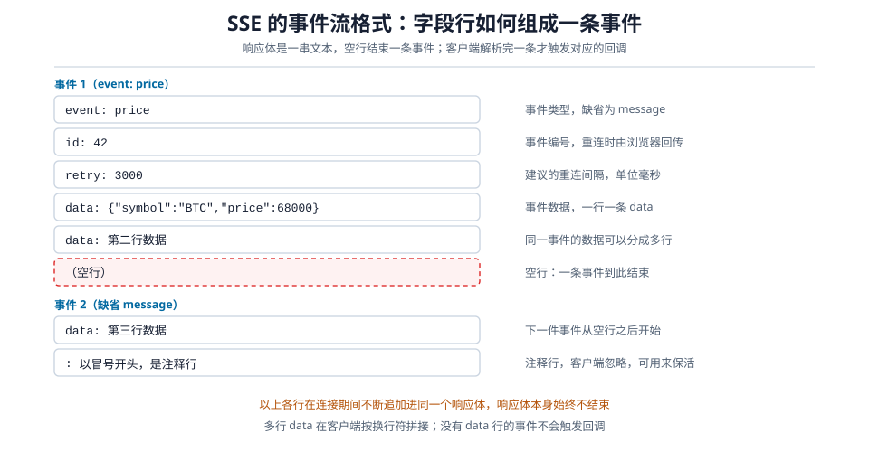
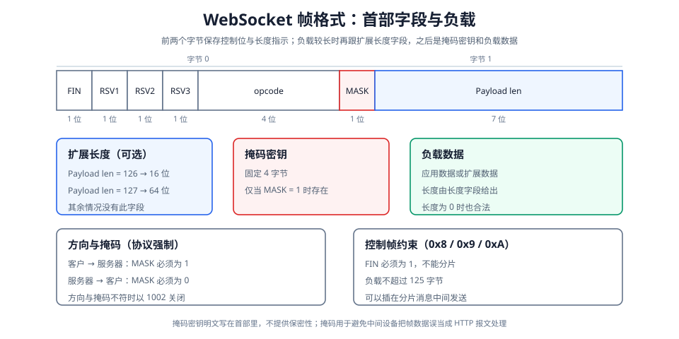

# 实时通信

实时通信要的是服务器一有新数据就送到客户。常规的 [[../posts/HTTP|HTTP]] 交换是请求/响应：客户发出请求，服务器返回应答。SSE 在一条应答上持续写事件，WebSocket 则另建双向消息通道。要在 Web 上实现服务器主动送数据，常见有四种做法。

1. **短轮询**：客户按固定间隔重复发请求。实现最简单，间隔越短空转越多，间隔越长延迟越大。
2. **长轮询**：服务器把请求挂起，有数据才应答。延迟因此变小，代价是每条消息仍要完成一次完整的请求/响应。
3. **SSE**（Server-Sent Events）：客户只请求一次，服务器在这条响应上持续推送文本事件。省掉了重复请求，代价是这条通道只承载服务器到客户的数据，HTTP/1.1 下同一域名的连接数也有限。
4. **WebSocket**：借一次 HTTP 请求完成握手，此后这条连接上双向传送帧，任何一方都可以随时发送。

| 维度 | 短轮询 | 长轮询 | SSE | WebSocket |
|---|---|---|---|---|
| 通信方向 | 请求/响应 | 请求/响应 | 服务器 → 客户单向 | 全双工 |
| 请求与连接 | 一次请求一次往返，连接可复用 | 每次等待占一条连接，连接可复用 | 一条长连接 | 一条长连接 |
| 每条消息的额外开销 | 一整套 HTTP 首部 | 一整套 HTTP 首部 | 事件文本格式 | 至少 2 字节基础帧首部，长度扩展与客户掩码另计 |
| 实时性 | 取决于轮询间隔 | 有数据后应答，仍有等待与超时 | 有数据即写，受代理缓冲影响 | 有数据即发，受网络与心跳影响 |
| 协议 | HTTP | HTTP | HTTP | 握手用 HTTP，之后是独立协议 |
| 断线重连 | 由应用发起下一次请求 | 由应用发起下一次请求 | 浏览器在可恢复情况下自动重连 | 需要应用实现重连与补发 |
| 适用场景 | 数据变化很慢、实现最简单 | 兼容性要求极高 | 只读的实时数据推送 | 双向实时交互 |

[html-card height=700](../assets/realtime-push-comparison-slides.html)

# SSE

**Server-Sent Events**（SSE）由 [HTML 标准](https://html.spec.whatwg.org/multipage/server-sent-events.html) 定义了 `EventSource` 接口与 `text/event-stream` 格式。客户只请求一次，服务器在这条连接上持续推送文本事件。

## 服务器如何推送

客户先发一个普通的 GET 请求，声明希望接收事件流：

```http
GET /prices HTTP/1.1
Host: example.com
Accept: text/event-stream
```

服务器同意用事件流作答时，返回 `200` 并声明响应体是事件流，然后**不结束这个响应体**：

```http
HTTP/1.1 200 OK
Content-Type: text/event-stream
Cache-Control: no-cache
Connection: keep-alive
```

到这一步，响应头已经发完，响应体保持打开。每发生一件事，就向这条响应追加一段文本并发出。

SSE 的接口与事件格式只定义服务器到客户的方向；底层 TCP 本身是全双工的，客户上行需要另发请求，这是 API 与格式的选择。

## 事件

**事件**是服务器发给客户的一条消息，由若干字段行组成，末尾用一个空行结束。含 `data` 字段的事件块在空行后触发一次回调；只含 `id`、`retry` 或注释行的事件块不触发数据回调。下图标出各字段的作用与分组方式：



| 字段 | 作用 |
|---|---|
| `data` | 事件携带的数据。可以分多行，每行前面都要写 `data:`，客户端按换行符拼起来 |
| `event` | 事件类型，缺省为 `message`，客户端按对应的事件名监听 |
| `id` | 服务器定义的游标（字符串），重连时浏览器把该值放进 `Last-Event-ID` 首部 |
| `retry` | 建议的重连间隔，单位毫秒 |
| `:` 开头的行 | 注释行，客户端忽略。可以定时发一个字符用来保活 |

## 客户端

浏览器内置 `EventSource`，不需要额外库：

```js
const es = new EventSource("/prices");

// 不写 event 字段的事件默认按 message 类型触发
es.onmessage = (e) => console.log("message", e.data);

// 监听 event: price 这类具名事件
es.addEventListener("price", (e) => {
  console.log(JSON.parse(e.data));
});

// 连接断开或出错时触发；可恢复的情况下浏览器会自动重连，非可恢复错误不会
es.onerror = () => console.log("readyState =", es.readyState);

es.close();   // 主动关闭
```

[html-card height=560](../assets/sse-reconnect-slides.html)

`Last-Event-ID` 只是游标。断线期间的事件需要服务器保留并可重放；没有保留策略时，客户端只能从重连后的新事件继续。

## 限制

- **方向只有服务器到客户**。客户要上行，只能另发一个 HTTP 请求，双向场景因此需要 SSE 加 POST 两条通道。
- **只能传文本**。二进制内容要先编码，例如转成 Base64 或放进 JSON 字符串。
- **`EventSource` 不能自定义请求首部**，无法像 `fetch` 那样加 `Authorization`。鉴权通常依靠 Cookie 等浏览器自动携带的凭据；需要自定义首部时，改用其他流式客户端。
- **HTTP/1.1 下一条 SSE 连接会占掉同域名并发连接数的一个名额**（常见限制为 6 个），多开标签页可能把名额用尽，同域名的其它请求被排队。HTTP/2 用多路复用缓解该瓶颈，流数量仍有上限。
- **中间设备的缓冲会破坏实时性**。反向代理可能攒够一批才转发，需要在网关侧关闭响应缓冲（Nginx 可设 `proxy_buffering off`，或由应用返回 `X-Accel-Buffering: no`），并放宽长连接的读超时。

# WebSocket

WebSocket 是独立的应用层协议（[RFC 6455](https://www.rfc-editor.org/rfc/rfc6455.html)），特点是**全双工连接**：先借一次 HTTP 请求完成握手；连接建立后，帧在两个方向上独立传送，任何一方都可以随时发送。

> [!note] 选择取决于方向与部署
> 方向、分帧方式、连接维护与应用负载共同决定选择。只做服务器单向推送时，SSE 基于纯文本与浏览器内建重连，部署更简单；需要双向低开销消息时，WebSocket 更合适。不存在适用于所有场景的延迟排序。

应用层以**消息**为单位收发，看到的是完整消息而不是字节流。

地址形式与 HTTP 对应：`ws://` 默认端口 80，`wss://` 默认端口 443（在 TLS 之上）。

## 协议升级握手

WebSocket 握手在 HTTP/1.1 上借用**协议升级**机制。

> [!note] 版本范围
> 本节的 `GET`、`Upgrade` 与 `101` 属于 HTTP/1.1。HTTP/2 上存在基于扩展 `CONNECT` 的 WebSocket（[RFC 8441](https://www.rfc-editor.org/rfc/rfc8441.html)），帧语义不变，握手承载方式不同。

[html-card height=660](../assets/websocket-handshake-slides.html)

### 客户的升级请求

客户先与服务器建立 TCP 连接，然后在连接上发送一个普通的 HTTP 请求，只是把方法固定为 `GET` 并加上升级相关的首部：

```http
GET /chat HTTP/1.1
Host: example.com
Upgrade: websocket
Connection: Upgrade
Sec-WebSocket-Key: dGhlIHNhbXBsZSBub25jZQ==
Sec-WebSocket-Version: 13
Origin: https://example.com
```

各首部的作用：

| 首部 | 作用 |
|---|---|
| `Upgrade: websocket` | 声明希望把这条连接升级为 WebSocket，不是要取一个资源 |
| `Connection: Upgrade` | HTTP/1.1 要求升级必须显式声明；中间设备缺少这一行可能不转发升级请求 |
| `Sec-WebSocket-Key` | 客户随机生成的 16 字节数据的 Base64 编码，用于让服务器证明其理解 WebSocket 协议 |
| `Sec-WebSocket-Version: 13` | 协议版本号；服务器不支持该版本时返回 `426 Upgrade Required` |
| `Origin` | 浏览器自动携带的来源信息；服务器据此校验请求是否来自允许的页面 |
| `Sec-WebSocket-Protocol` | 可选首部，列出客户支持的子协议，如 `graphql-transport-ws`、`mqtt` |
| `Sec-WebSocket-Extensions` | 可选首部，列出客户希望启用的扩展，如 `permessage-deflate` 压缩 |

两个可选首部需要双方都同意：服务器从客户列出的子协议里选一个，并通过 `Sec-WebSocket-Protocol` 返回，扩展同理。

`Origin` 需要单独处理：WebSocket 不受同源策略限制，跨域页面同样能发起连接。服务器应检查 `Origin` 是否来自允许的页面，以减少跨站 WebSocket 劫持风险；`Origin` 只用于来源判断，不证明身份。

### 服务器的升级响应

服务器同意升级时，返回表示协议切换的 `101`：

```http
HTTP/1.1 101 Switching Protocols
Upgrade: websocket
Connection: Upgrade
Sec-WebSocket-Accept: s3pPLMBiTxaQ9kYGzzhZRbK+xOo=
```

`Sec-WebSocket-Accept` 由客户的 `Sec-WebSocket-Key` 计算得到。把该值与协议规定的固定字符串 `258EAFA5-E914-47DA-95CA-C5AB0DC85B11` 拼接，取 SHA-1 摘要后再做 Base64 编码：

$$
\text{Sec-WebSocket-Accept} = \text{Base64}\!\left(\text{SHA-1}\!\left(\text{Sec-WebSocket-Key} \parallel \text{GUID}\right)\right)
$$

客户收到响应后会重算一遍并比对。这一步确认对方能按 WebSocket 协议计算 Accept，属于协议参与验证，不提供身份认证与加密。固定 GUID 让这次升级请求与普通 HTTP 请求的响应计算无法互相冒充。

`101` 的语义是**切换协议**。此后双方按 WebSocket 帧格式解析字节，不再解析 HTTP。

服务器不同意升级时会返回 `400`、`403`、`426` 之类的普通响应，客户把该响应当作本次连接的失败结果即可，连接不会升级。

## 帧

握手完成后，这条连接上的数据单位是**帧**（frame）。



### 帧的组成

帧首部的前两个字节固定，其余部分长度可变；长度字段必须用**最短的**表示方式，能用 7 位就不要用 16 位：

| 字段 | 长度 | 说明 |
|---|---|---|
| **FIN** | 1 位 | 值为 1 表示这是当前消息的最后一帧，值为 0 表示后面还有分片 |
| **RSV1**、**RSV2**、**RSV3** | 各 1 位 | 保留位，没有协商对应扩展时必须为 0 |
| **opcode** | 4 位 | 帧类型，取值见下节 |
| **MASK** | 1 位 | 值为 1 表示负载被掩码，此时首部中还有 4 字节掩码密钥 |
| **Payload len** | 7 位 | 0～125 直接表示负载长度；为 126 时后随 16 位长度；为 127 时后随 64 位长度 |
| **Extended payload length** | 0／16／64 位 | 负载较长时补充的长度字段 |
| **Masking-key** | 0 或 32 位 | `MASK` 为 1 时存在，负载数据逐字节与密钥异或 |
| **Payload data** | 可变 | 应用数据或扩展数据 |

### opcode

opcode 决定这一帧承载什么内容，取值分两类。承载应用数据的是数据帧，只有三个取值：

| opcode | 名称 | 说明 |
|---|---|---|
| `0x0` | Continuation | 同一条消息的后续分片 |
| `0x1` | Text | 负载是 UTF-8 文本 |
| `0x2` | Binary | 负载是二进制数据 |

控制帧不携带应用数据，只负责管理连接本身，取值同样只有三个。控制帧**不能分片**（FIN 必须为 1）、**负载不超过 125 字节**，但**可以插在一条分片消息的中间**发送，所以长消息传输过程中也能及时处理关闭和心跳：

| opcode | 名称 | 说明 |
|---|---|---|
| `0x8` | Close | 发起或应答关闭握手 |
| `0x9` | Ping | 探测对方是否仍在，收到方应回 Pong |
| `0xA` | Pong | 对 Ping 的应答 |

### 掩码

掩码是协议强制的，不允许协商取消：客户发往服务器的帧，`MASK` 必须为 1，负载用 4 字节随机密钥逐字节异或；服务器发往客户的帧，`MASK` 必须为 0，负载不加任何处理。接收方发现方向与掩码规则不符时，按协议错误（状态码 1002）关闭连接。

掩码不是为了加密，因为密钥就写在同一个帧的首部里，任何人都能还原。掩码的目的是**防止中间设备误解析**：如果一个被缓存的 WebSocket 数据恰好看起来像一条 HTTP 请求，不理解协议的代理或缓存就可能按 HTTP 处理并污染缓存。加上随机的掩码后，数据无法被伪造成合法的 HTTP 请求。

### 消息与帧的关系

一条**消息**由一帧或多帧组成。短消息用一个 FIN 为 1 的数据帧承载。长消息拆成一个 FIN 为 0 的首帧、若干 `0x0` 且 FIN 为 0 的中间帧，以及最后一帧 `0x0` 且 FIN 为 1 的收尾帧。

接收方按 FIN 与 opcode 把分片拼成完整消息后才交给应用，所以应用只看到消息。一条 Text 消息的完整负载必须是合法 UTF-8，否则以状态码 1007 关闭；分片可能把一个多字节字符拆到两帧，单个中间帧不必能独立解码。

## 连接维护

### 心跳

WebSocket 连接是长连接，长时间没有数据时可能被中间的 NAT 或防火墙静默回收，两端都以为连接还在，实际已经不可用。协议为此提供了 Ping／Pong 控制帧：一侧发送 Ping，另一侧应尽快回送负载相同的 Pong。浏览器的 JavaScript 接口没有直接发送 Ping 帧的方法，应用层心跳通常是自定义消息，与协议层 Ping 是两件事。

### 关闭握手

正常关闭先交换 Close 帧，再断开 TCP 连接：

1. 一方发送 Close 帧，可携带 2 字节状态码和一段原因说明。
2. 另一方回送 Close 帧。
3. 双方随后断开 TCP 连接。

常用状态码：

| 状态码 | 含义 |
|---|---|
| `1000` | 正常关闭 |
| `1001` | 端点离开（如页面被关闭、服务器下线） |
| `1002` | 协议错误（如掩码方向不符、保留位不为 0） |
| `1003` | 收到无法接受的数据类型 |
| `1007` | 重组后的 Text 消息不是合法 UTF-8 |
| `1008` | 违反策略（如未通过鉴权） |
| `1009` | 消息过大 |
| `1011` | 服务器遇到非预期情况 |
| `1006` | 连接异常关闭，**只在本机上报**，不会出现在线上传出的 Close 帧中 |

# 选择与部署

需要双向消息时用 WebSocket，例如聊天、多人协作、远程终端与游戏输入；只需要服务器单向推送时用 SSE，例如行情、通知、任务进度与监控刷新。SSE 的协议是纯文本，重连由浏览器处理，服务端把事件写进一条响应即可。

HTTP/1.1 部署时，WebSocket 需要代理显式转发 `Upgrade` 与 `Connection` 首部，否则握手失败；SSE 需要关闭响应缓冲，否则事件被攒批转发。两者都需要放宽长连接的读超时，例如 Nginx 的 `proxy_read_timeout`。
