# 初始化的目标

初始化决定训练开始时的参数取值。初始化需要兼顾以下目标：

1. 同一层的不同单元要能学到不同的特征。
2. 信号在层间的尺度大致保持，不逐层放大或衰减。
3. 梯度在反向传播中不消失也不爆炸。

第一条由对称性分析给出，第二条由方差在层间的传播推出，第三条由反向连乘的幅度决定。训练开始后的分布漂移不归初始化处理，相关机制见 [[Batch-Norm-And-Layer-Norm]]。

# 对称性

若同层各单元的输入权重向量、输出连接权重、偏置与优化器状态完全相同，各单元就会产生相同的激活与梯度，更新后仍保持相同。该层只产生同一表示的重复副本，表示能力相当于一个单元。

如果输出层对各单元的权重不同，即使输入侧权重相同，各单元收到的上游梯度也不同，更新后就会分开。实践中通常用随机初始化打破单元之间的对称性，让各单元从不同的起点出发。

全零初始化在单层线性模型或逻辑回归上可以正常训练，因为没有需要区分彼此的隐藏单元。偏置通常初始化为 0；偏置不参与输入侧的特征区分，权重随机化之后，各单元对同一输入的加权结果已经不同，梯度随之不同。

# 方差的传播

考虑一个线性层，输入 $x_j$ 与权重 $w_{ij}$ 相互独立、都取零均值、方差有限；权重在各坐标上相互独立。预激活及其方差为：

$$
z_i = \sum_{j=1}^{n} w_{ij} x_j \quad\Rightarrow\quad \operatorname{Var}(z_i) = \sum_{j=1}^{n} \operatorname{Var}(w_{ij})\operatorname{Var}(x_j) = n \cdot \operatorname{Var}(w) \cdot \operatorname{Var}(x)
$$

其中 $n$ 定义为 fan_in，是这一层每个单元接收的输入个数，$\text{fan\_out}$ 是这一层的输出单元个数。要使输出方差等于输入方差，权重方差取：

$$
\operatorname{Var}(w) = \frac{1}{\text{fan\_in}}
$$

这是期望意义上的等式，前提是权重与输入独立、各坐标方差一致。真实网络的有限样本方差会在附近波动，不会层层精确守恒。

取 fan\_in $= 100$、输入方差为 1、权重方差为 0.01，输出方差期望是 1。把权重方差改成 0.02，每层放大 2 倍，20 层后放大 $2^{20} \approx 1.05 \times 10^{6}$ 倍；改成 0.005，每层缩小一半，20 层后只剩百万分之一。



图中上方是纯线性串联的精确值：每层乘 1.5，20 层后放大 3325 倍；每层乘 0.8，20 层后只剩 0.0115。下方是 15 层 tanh 网络的实测：即使权重尺度取 $1/\sqrt{\text{fan\_in}}$，输出标准差也从 0.98 降到 0.19，因为 tanh 的饱和额外压缩了信号。

# ReLU 之后的二阶矩

下一层的方差由输入的二阶矩决定，所以 ReLU 截断负半轴之后，要看二阶矩变成多少。设预激活 $z$ 关于 0 对称，$a = \max(0, z)$，由对称性可得：

$$
\mathbb{E}[a^2] = \int_0^{\infty} z^2 p(z)\,\mathrm{d}z = \frac{1}{2}\mathbb{E}[z^2]
$$

二阶矩减半对任意零均值对称分布都成立。方差与二阶矩的关系为：

$$
\operatorname{Var}(a) = \mathbb{E}[a^2] - \left(\mathbb{E}[a]\right)^2
$$

方差还要减去均值的平方，而均值没有通用的闭式表达。若进一步假设 $z \sim \mathcal{N}(0, \sigma^2)$，可得均值与方差：

$$
\mathbb{E}[a] = \frac{\sigma}{\sqrt{2\pi}}, \qquad \operatorname{Var}(a) = \frac{\sigma^2}{2} - \frac{\sigma^2}{2\pi} \approx 0.341\,\sigma^2
$$

> [!important] 0.341 依赖高斯假设
>
> 对称输入经过 ReLU，二阶矩为原来的一半；高斯输入下，ReLU 输出的方差约为原来的 0.341 倍。两项结论的前提不同。

# 初始化方法

## Xavier 初始化

Xavier 初始化同时照顾前向与反向：前向希望权重方差接近 $1/\text{fan\_in}$，反向希望接近 $1/\text{fan\_out}$，两者折中（[Glorot 与 Bengio](https://proceedings.mlr.press/v9/glorot10a.html)）：

$$
\operatorname{Var}(W) = \frac{2}{\text{fan\_in} + \text{fan\_out}}
$$

Xavier 的条件是：激活函数在零附近近似线性，输入与输出零均值，权重独立同分布且关于 0 对称，相邻层宽度可比。这些条件与 tanh 在线性区的行为大致相符，所以 Xavier 常被描述为配合 tanh 与 sigmoid 的经典尺度。

sigmoid 并不满足全部条件：$\sigma(0) = 0.5$，非零中心；$\sigma'(0) = 0.25$，局部斜率不是 1。把 Xavier 用在 sigmoid 上仍能给出可用结果，原因是在这些偏离下 Xavier 给出的量级相近。

## He 初始化

He 初始化针对 ReLU 修正了尺度（[He 等](https://arxiv.org/abs/1502.01852)）。设进入某层的预激活 $z$ 零均值、分布关于 0 对称、方差为 $q$。经过 ReLU 得 $a = \max(0,z)$，由对称性有 $\mathbb{E}[a^2] = q/2$。

下一层的预激活是 $z' = \sum_{j=1}^{\text{fan\_in}} w_j a_j$，各权重相互独立、与 $a$ 独立，且权重均值为 0。下一层预激活的方差为：

$$
\operatorname{Var}(z') = \text{fan\_in} \cdot \operatorname{Var}(w) \cdot \mathbb{E}[a^2] = \text{fan\_in} \cdot \operatorname{Var}(w) \cdot \frac{q}{2}
$$

要使 $\operatorname{Var}(z') = q$，权重方差取：

$$
\operatorname{Var}(W) = \frac{2}{\text{fan\_in}}
$$

式中的 2 来自对称零均值输入下 ReLU 的二阶矩减半；输入分布不对称时，这一步不成立。

对负半轴斜率为 $\alpha$ 的 Leaky ReLU，同样的推导给出 $\operatorname{Var}(W) = 2/\left((1+\alpha^2)\,\text{fan\_in}\right)$；$\alpha = 0$ 时回到 ReLU 的结论，$\alpha = 1$ 时退化成恒等映射的 $1/\text{fan\_in}$。

# 框架默认行为

PyTorch 的 `nn.Linear` 在构造时就初始化了权重，默认从 $[-1/\sqrt{\text{fan\_in}}, 1/\sqrt{\text{fan\_in}}]$ 上的均匀分布采样（见 [nn.Linear 文档](https://pytorch.org/docs/stable/generated/torch.nn.Linear.html)）。均匀分布的方差是区间长度平方的 $1/12$，因此默认权重方差为：

$$
\operatorname{Var}(W) = \frac{1}{12}\left(\frac{2}{\sqrt{\text{fan\_in}}}\right)^2 = \frac{1}{3\,\text{fan\_in}}
$$

与 He 的 $2/\text{fan\_in}$ 相比，方差比是 $1/6$，标准差比是 $1/\sqrt{6} \approx 0.408$，默认尺度大约是标准 He 的四成。偏置默认从同样量级的均匀分布采样。

`kaiming_*` 的采样标准差等于增益乘以 $1/\sqrt{\text{fan\_in}}$，增益为 $\sqrt{2/(1+a^2)}$，即采样标准差的缩放系数。两个入口的取值不同：

| 入口 | `a` 的取值 | 增益 | 采样标准差 |
| --- | --- | --- | --- |
| `nn.Linear` 的 `reset_parameters` | $\sqrt{5}$ | $0.577$ | $0.577/\sqrt{\text{fan\_in}}$ |
| 公开的 `kaiming_*` 默认参数 | $0$ | $\sqrt{2}$ | $\sqrt{2}/\sqrt{\text{fan\_in}}$ |

公开的 `kaiming_*` 函数里，`nonlinearity` 默认是 `'leaky_relu'`，对应的 `a` 默认值却是 $0$，此时增益为 $\sqrt{2}$，与 ReLU 相同。写 `nonlinearity='relu'` 让意图更清楚，得到的增益一致。需要非零 `a`（例如给 Leaky ReLU 补偿负半轴）时，这个参数才真正改变尺度。

```python
import torch
from torch import nn

layer = nn.Linear(256, 128)
# 显式写出 nonlinearity 更易读；默认 a=0 给出同一增益
nn.init.kaiming_normal_(layer.weight, nonlinearity="relu")
```

中等深度并配合归一化时，默认尺度与标准 He 的差距通常仍在可训练范围内，因此不调 `init` 也能完成训练；纯 ReLU 的深层网络建议手动覆盖。

# 选型

| 激活函数 | 常用初始化 | 权重方差 | 说明 |
| --- | --- | --- | --- |
| ReLU | He / Kaiming | $2/\text{fan\_in}$ | 补回负半轴被截掉的二阶矩 |
| Leaky ReLU（斜率 $\alpha$） | He 变体 | $2/\left((1+\alpha^2)\text{fan\_in}\right)$ | 负半轴斜率参与二阶矩 |
| tanh、sigmoid | Xavier / Glorot | $2/(\text{fan\_in}+\text{fan\_out})$ | 假设工作在线性区 |
| 恒等（无激活） | 方差守恒 | $1/\text{fan\_in}$ | 线性层的直接结论 |
| 深层且带归一化 | 仍需按激活选择 | 视层而定 | 归一化吸收部分尺度偏差，不能替代尺度选择 |

